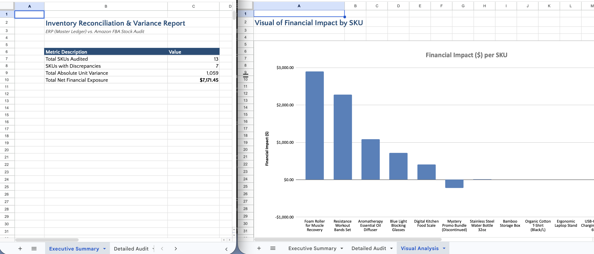

# Inventory Audit & Reconciliation Engine

A supply chain tool to compare master ledgers (ERP) with external provider logs (Amazon FBA). It isolates stock variances, calculates financial impact, and then generates multi-tab Excel reports.



---

## Table of Contents
- [Key Features & Business Impact](#key-features--business-impact)
- [Tech Stack](#tech-stack)
- [Installation](#installation)
- [How to Run](#how-to-run)

## Key Features & Business Impact
* **Data Reconciliation:** Uses full outer joins to merge disjointed ERP and Amazon FBA data and catch missing/unlisted inventory.
* **Financial Modeling:** Uses dynamic fallback logic to resolve unit cost and calculate total dollar exposure with no missing data.
* **Risk-Based Audit Engine:** Programmatically flags high-risk SKUs (`Action Required`, `Minor Variance`, `Missing`) based on configurable quantity and cash thresholds.
* **Multi-Tab Reporting:** Programmatically generates Excel report (`Reconciliation_Report.xlsx`) with KPIs, `=SUM()` totals, and a visual bar chart for financial impact.

## Tech Stack
* **Language:** Python 3
* **Data Processing:** pandas
* **Spreadsheet Engine & Visualization:** openpyxl
* **Version Control:** Git / GitHub

---

## Installation
1.  **Clone the repository:**
    ```bash
    git clone [https://github.com/seanavers/inventory-audit.git](https://github.com/seanavers/inventory-audit.git)
    ```
2.  **Navigate to the project directory:**
    ```bash
    cd inventory-audit
    ```
3.  **Install dependencies:**
    ```bash
    pip3 install -r requirements.txt
    ```

---

## How to Run
1. Navigate to the project directory in your terminal and execute the reconciliation script:

```bash
python3 reconcile.py
```

2. Drag `Reconciliation_Report.xslx` to Google Sheets to view multi-tab Excel reports